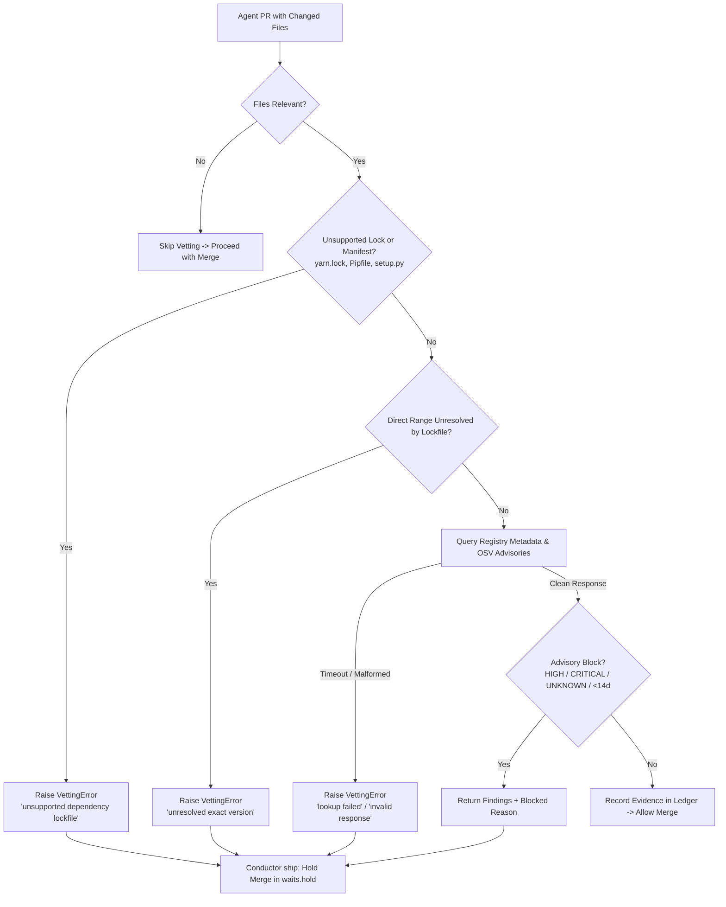

# Security Audit: Dependency Inventory and Fail-Closed Scan Evidence (#1628, #1632)

**Audited SHA:** `48f30e7e534214c00017bc8a88660a13373713b3`  
**Planning Baseline SHA:** `dbde249fd68560bf2377826a581ded962c62c27c`  
**Audit Date:** 2026-11-21  
**Part of:** #1628 (Security & Surface Area Audit)  
**Deliverable:** Dated exposure inventory, fail-closed scanner evaluation, public advisory lookups, and synthetic regression test coverage (`tests/test_security_dependency_audit.py`).

---

## 1. Executive Summary

This audit establishes a dated inventory of declared dependency exposures for the Mahler repository, tests the fail-closed error handling of Mahler's dependency vetting scanner, and documents public advisory statuses without introducing runtime dependencies.

Key conclusions:
1. **Core Package Purity:** The core `mahler` package strictly maintains a standard-library-only contract across all 42 modules in `mahler/*.py` and `mahler/console/*.py`. Zero external third-party dependencies are required for the daemon, console, scheduler, ledger, or conductor.
2. **Scanner Fail-Closed Guarantees:** Mahler's dependency vetting engine (`mahler/dependency_vetting.py`) and shipping conductor integration (`mahler/ship.py`) fail closed across all five evaluated failure boundaries: malformed registry responses, network timeouts, unresolved version ranges, high/critical/unknown advisory scores, and unsupported lockfile formats. Furthermore, the shipping conductor refuses to dispatch fix runs when review reports missing or disputed gate evidence, entering bounded holds rather than risking unvetted merges.
3. **Identified Coverage Gaps & Limitations:**
   - `sdk_runner/pyproject.toml` declares open minimum version ranges (`claude-agent-sdk>=0.2.165`, `setuptools>=68`) without a pinned lockfile (`uv.lock` or `poetry.lock`). Transitive dependency coverage for `sdk_runner` is therefore **unknown**. Snapshot lookup found that `setuptools==68.0.0` is exposed to public advisories; later snapshots such as `setuptools==75.0.0` remain exposed to separate advisories and must not be described as vulnerability-free.
   - `.github/dependabot.yml` configures automated updates solely for `github-actions`. There is no automated Dependabot or scanner coverage for `sdk_runner/pyproject.toml`.
   - `.github/workflows/ci.yml` uses mutable major tags (`actions/checkout@v7`, `actions/setup-python@v7`) rather than immutable commit SHAs.

---

## 2. Dependency Exposure Inventory

### 2.1 Configuration Files Inventory

| Configuration File | Declared Requirements / References | Pinning / Range Type | Automated Update Coverage |
|---|---|---|---|
| `sdk_runner/pyproject.toml` | `claude-agent-sdk>=0.2.165`<br>`setuptools>=68` (build-system) | Open minimum ranges (`>=`); no upper bounds; no lockfile (`uv.lock`/`poetry.lock`) | **None** (omitted from `.github/dependabot.yml`) |
| `.github/workflows/ci.yml` | `actions/checkout@v7`<br>`actions/setup-python@v7` | Mutable major release tag (`@v7`); not pinned to immutable commit SHA | Dependabot (`github-actions`, weekly) |
| `.github/dependabot.yml` | `package-ecosystem: "github-actions"`, `directory: "/"`, `schedule.interval: "weekly"`, `groups.actions: {update-types: ["minor", "patch"]}` | Grouped weekly PRs for Actions | Active for Actions only; **0% coverage for PyPI / sdk_runner** |

### 2.2 Core Standard-Library Contract (`mahler/*.py`, `mahler/console/*.py`)

An AST parsing inspection of all 42 Python source files in `mahler/` and `mahler/console/` confirmed that all non-relative imports belong strictly to Python 3.14 standard library modules:
- Standard library modules imported: `argparse`, `base64`, `binascii`, `calendar`, `collections`, `contextlib`, `copy`, `dataclasses`, `datetime`, `decimal`, `email`, `fcntl`, `glob`, `hashlib`, `html`, `http`, `ipaddress`, `itertools`, `json`, `logging`, `math`, `os`, `pathlib`, `plistlib`, `re`, `secrets`, `selectors`, `shlex`, `shutil`, `signal`, `socket`, `sqlite3`, `stat`, `statistics`, `string`, `subprocess`, `sys`, `tempfile`, `threading`, `time`, `tomllib`, `types`, `typing`, `urllib`, `uuid`, `xml`, `zlib`, `zoneinfo`.
- Internal helper imports: `mahler/console_walkthrough.py` imports `make_cfg` and `make_led` from `tests.test_serve` to construct an in-memory test ledger during manual walkthroughs. No external packages are used.
- **Contract Verdict:** `supported`. The core daemon introduces no third-party supply-chain exposure.

### 2.3 Separation of Shipped Dependencies vs Externally Installed Agent CLIs

| Classification | Components | Delivery & Execution Boundary | Security & Supply Chain Scope |
|---|---|---|---|
| **Shipped Core** | `mahler` package (`mahler/*.py`, `mahler/console/`) | Standard library, executed by daemon (`~/.mahler/app`) | Zero external runtime dependencies. Governed by Python 3.14 standard library security profile. |
| **Shipped Tool Sub-package** | `sdk_runner/` (`mahler-sdk-run`) | Standalone sub-package installed via `uv tool install ./sdk_runner` | Depends on `claude-agent-sdk` and `setuptools`. Has separate virtualenv; isolated from core Mahler daemon. |
| **Externally Installed CLIs** | Claude Code (`claude`), Antigravity (`agy`), Cline (`cline`), GitHub CLI (`gh`), Codex, Copilot, Kilo | System executables installed on host Mac mini outside Mahler; managed via platform CLI adapters (`mahler/platforms.py`) | Subprocess execution with argument sanitization and scoped GitHub App tokens (DESIGN D25, D47). Not shipped Python dependencies. |

---

## 3. Dependency Vetting Scanner Failure Boundaries

Mahler conducts fail-closed vetting of all dependency changes in pull requests before allowing merge (`mahler/dependency_vetting.py`, integrated into conductor shipping in `mahler/ship.py`).

The scanner was evaluated against five distinct failure boundaries, plus caller refusal under missing evidence:



### 3.1 Evaluation of Five Failure Cases

| Failure Case | Implementation & Source Location | Behavior & Fail-Closed Status | Caller Integration (`mahler/ship.py`) | Verdict |
|---|---|---|---|---|
| **1. Malformed Registry Response** | `_request_json` (lines 831-840)<br>`_metadata` (lines 871-912)<br>`_advisories` (lines 1236-1248)<br>`_severity` (lines 1194-1226) | **Fails closed.** Catches `JSONDecodeError`, `UnicodeError`, schema type mismatches (`not isinstance(dict)`), missing publication dates, or bad OSV pages (`next_page_token`). Raises `VettingError`. | `_vet_gate` catches `VettingError`, logs error to console, returns detail. `_vet_pr_dependencies` refuses merge, calls `_hold_dependency_vetting`, and records bounded hold in `waits.hold(..., "dependency_vetting", ...)`. | `supported` |
| **2. Network Timeout** | `_registry_request` (lines 811-822)<br>`_request_json` (lines 839-840) | **Fails closed.** Transport calls enforce `timeout=20`. Retries `URLError`/`TimeoutError`/`OSError` once. If still failing, raises `VettingError("registry/advisory lookup failed: ...")`. | `_vet_gate` captures failure string. Conductor releases lease, enters bounded wait without merging. Duplicate pings suppressed. | `supported` |
| **3. Unresolved Python Dependency Range** | `_changed_project_dependencies` (lines 763-784)<br>`vet` (lines 1259-1262) | **Fails closed.** Non-exact declarations (`>=`, `~=`, `^`, `*`) without a matching `uv.lock` or `poetry.lock` leave `version = None`. `vet()` raises `VettingError("unresolved exact version for ...")` before making any network calls. | Conductor blocks PR merge. Posts actionable explanation instructing agent to supply exact pin or lockfile. | `supported` |
| **4. Advisory Severity Requiring Block** | `_severity` (lines 1202-1226)<br>`_advisories` (lines 1245-1248)<br>`vet` (lines 1276-1289) | **Fails closed.** Evaluates CVSS v3 vectors, scores, and database severities. `HIGH`, `CRITICAL`, and `UNKNOWN` severities mark finding `blocked = True` and return blocking reason. Also blocks publications < 14 days old. | `_vet_gate` detects `blocked is not None`, logs blocking reason, halts shipping, holds PR, posts finding comment. | `supported` |
| **5. Unsupported Manifest / Lock Format** | `_UNSUPPORTED_LOCKS` (lines 56-59)<br>`_changed_project_dependencies` (lines 702-709)<br>`relevant_path` (lines 69-70)<br>`gh.dependency_files` (lines 1137-1162) | **Partially supported, concrete gap.** Known unsupported names that reach `_changed_project_dependencies` raise `VettingError`. However, `Cargo.toml` and `Cargo.lock` do not match `_RELEVANT`, and `gh.dependency_files` returns `{}`, `{}` before `_changed_project_dependencies` can inspect them. A Cargo-only change is therefore recorded with clean/no-change evidence rather than rejected. | `_vet_gate` sees no changed dependencies and records `clean: true`; `_vet_pr_dependencies` allows the merge. Impact: Rust dependency changes can bypass advisory/lock evidence in this gate. | `coverage gap / defect` |
| **Missing Gate Evidence Refusal** | `_all_missing_gate_evidence` (lines 2492-2538)<br>`_review_triggered_fix` (lines 2557-2563) | **Fails closed.** If adversarial review findings indicate missing or disputed conductor dependency-vetting gate evidence, caller refuses to start a fix run or escalate tier. | Caller holds PR in bounded wait (`kind="evidence"`, `waits.hold`) and releases conductor lease. Prevents looping or bypassing evidence. | `supported` |

---

## 4. Public Advisory Lookups (Audited Date: 2026-11-21)

All queries were intended against unauthenticated public registry endpoints (`pypi.org`, `api.osv.dev`, `github.com`). Per audit protocol, open ranges and mutable tags are labeled with exact queried snapshots, and deployed/transitive coverage is reported as **unknown**. Direct PyPI DNS access was unavailable from this audit run; that failed lookup is not converted into a clean result. GitHub tag resolution and public advisory evidence were available.

### 4.1 Findings Table

| Target Name | Ecosystem | Declared Ref / Specifier | Queried Version / Snapshot | Source Query URL | Advisory Status / Findings | Transitive / Deployed Coverage |
|---|---|---|---|---|---|---|
| `claude-agent-sdk` | PyPI | `>=0.2.165` | `0.2.165` and `0.2.187` proposed snapshots; neither is a resolved deployment snapshot | `https://api.osv.dev/v1/query`<br>`https://pypi.org/pypi/claude-agent-sdk/json` | Direct PyPI lookup was unavailable; public OSV search shows historical advisory `GHSA-h4mw-j7qp-8mwm` (argument injection via `resume`, affected `<0.2.121`, fixed in `0.2.121`). **Advisory status for the declared range and exact deployment snapshot is UNKNOWN, not clean.** | **UNKNOWN.** No lockfile exists. Sub-dependencies (`anthropic`, `pydantic`, `anyio`, etc.) are unpinned. |
| `setuptools` | PyPI (build) | `>=68` | `68.0.0` (minimum satisfying bound), `75.0.0` (clearly labeled vulnerable snapshot) | `https://api.osv.dev/v1/query`<br>`https://pypi.org/pypi/setuptools/json`<br>`https://github.com/pypa/setuptools/security/advisories/GHSA-5rjg-fvgr-3xxf` | Public evidence for `75.0.0` still lists `GHSA-5rjg-fvgr-3xxf` (fixed in `>=78.1.1`), `GHSA-h35f-9h28-mq5c` (fixed in `>=83.0.0`), and `GHSA-xmj3-9gf7-h52w` (fixed in `>=84.1.0`). Earlier snapshot `68.0.0` also has public advisory exposure. **No clean or vulnerability-free resolution is asserted.** | **UNKNOWN.** Host environment resolver determines exact installed version during `uv tool install`; deployed and transitive build-tool versions are not recorded. |
| `actions/checkout` | GitHub Actions | `@v7` | Tag `v7` (`3d3c42e5aac5ba805825da76410c181273ba90b1`, matching release `v7.0.1`) | `https://api.osv.dev/v1/query`<br>`https://github.com/actions/checkout.git` | **0 known advisories in OSV.** | **UNKNOWN / Mutable Tag.** Tag `@v7` is mutable; deployed action script depends on GitHub release ref. |
| `actions/setup-python` | GitHub Actions | `@v7` | Tag `v7` (`6d4fd22b20465ccc0f7354476588e8df7c9ca0e0`, matching release `v7.1.0`) | `https://api.osv.dev/v1/query`<br>`https://github.com/actions/setup-python.git` | **0 known advisories in OSV.** | **UNKNOWN / Mutable Tag.** Tag `@v7` is mutable; runner node environment and runtime scripts unpinned. |

---

## 5. Summary of Audit Verdicts and Boundaries

| Boundary | Audited SHA | Source Symbols | Test Selectors | Verdict | Evidence & Notes |
|---|---|---|---|---|---|
| **Core Standard-Library Contract** | `48f30e7` | `mahler/*.py`, `mahler/console/*.py` | `tests.test_security_dependency_audit` | **supported** | Zero third-party dependencies; 100% standard library imports across all core modules. |
| **SDK Runner Version Pinning** | `48f30e7` | `sdk_runner/pyproject.toml` | `test_sdk_runner_pyproject_unpinned_range_fails_closed_without_lockfile` | **coverage gap** | Uses `>=` ranges without lockfile. Vetting engine correctly blocks PR changes lacking exact versions, but existing static files lack lockfile. |
| **Dependabot Update Scope** | `48f30e7` | `.github/dependabot.yml` | Inspection of configuration | **coverage gap** | Only GitHub Actions are monitored. No Dependabot coverage for `sdk_runner/pyproject.toml`. |
| **Workflow Action Ref Immutability** | `48f30e7` | `.github/workflows/ci.yml` | Inspection of workflow refs | **accepted limitation** | Actions use `@v7` mutable tags instead of full commit SHAs. Dependabot maintains weekly minor/patch updates. |
| **Malformed Registry Response Handling** | `48f30e7` | `mahler.dependency_vetting._request_json`, `_metadata` | `test_malformed_registry_response_and_caller_refusal` | **supported** | The malformed-JSON branch is reached independently and raises `VettingError`; conductor caller halts merge and enters bounded hold. |
| **Network Timeout Handling** | `48f30e7` | `mahler.dependency_vetting._registry_request` | `test_network_timeout_and_caller_refusal` | **supported** | Transport timeout retries are exercised independently and persistent timeouts raise `VettingError`; conductor halts merge. |
| **Unresolved Dependency Range Handling** | `48f30e7` | `mahler.dependency_vetting._changed_project_dependencies`, `vet` | `test_unresolved_python_range_and_unsupported_lock_combination_fails_closed` | **supported** | Open ranges without lockfiles fail closed before network requests. |
| **Advisory Severity Blocking** | `48f30e7` | `mahler.dependency_vetting._severity`, `_advisories` | `test_advisory_block_and_caller_missing_evidence_refusal` | **supported** | HIGH, CRITICAL, and UNKNOWN advisories block merge. |
| **Unsupported Lockfile Handling** | `48f30e7` | `mahler.dependency_vetting._UNSUPPORTED_LOCKS`, `_RELEVANT`, `mahler.gh.GH.dependency_files` | `test_unresolved_python_range_and_unsupported_lock_combination_fails_closed`, `test_cargo_only_change_is_a_documented_gate_bypass` | **coverage gap / defect** | Known unsupported lockfiles raise `VettingError`, but Cargo.toml/Cargo.lock are absent from `relevant_path`, so `gh.dependency_files` returns no snapshots and the caller records clean/no-change evidence. |
| **Missing Gate Evidence Refusal** | `48f30e7` | `mahler.ship._all_missing_gate_evidence`, `_review_triggered_fix` | `test_advisory_block_and_caller_missing_evidence_refusal` | **supported** | Conductor refuses review-fix escalation when gate evidence is missing or disputed. |

---

## 6. Remediation Proposals

The following bounded remediation proposals address the identified coverage gaps and accepted limitations:

1. **Provide a Resolved Lockfile for `sdk_runner`:**
   - *Proposal:* Generate and commit `sdk_runner/uv.lock` with an exact, currently vetted `claude-agent-sdk` snapshot and an exact `setuptools` snapshot not affected by the identified advisories (for example, do not infer safety from `>=75.0.0`; require evidence for a fixed version or remove the build-time dependency). Re-run public advisory lookup after resolution.
   - *Impact:* Provides reproducible installed-version evidence and removes the range-based ambiguity without asserting a clean build based on an unavailable lock or registry response.

2. **Add PyPI Ecosystem to Dependabot:**
   - *Proposal:* Update `.github/dependabot.yml` to include:
     ```yaml
     - package-ecosystem: "pip"
       directory: "/sdk_runner"
       schedule:
         interval: "weekly"
     ```
   - *Impact:* Ensures automated monitoring and PR creation for updates to `sdk_runner/pyproject.toml`.

3. **Pin GitHub Actions to Immutable Commit SHAs:**
   - *Proposal:* Pin `actions/checkout` and `actions/setup-python` in `.github/workflows/ci.yml` to immutable commit SHAs with inline version comments:
     ```yaml
     - uses: actions/checkout@3d3c42e5aac5ba805825da76410c181273ba90b1 # v7.0.1
     - uses: actions/setup-python@6d4fd22b20465ccc0f7354476588e8df7c9ca0e0 # v7.1.0
     ```
   - *Impact:* Prevents third-party tag mutation attacks in CI workflows while Dependabot continues to manage updates.

4. **Recognize Cargo Manifests and Locks in the Gate:**
   - *Proposal:* Add `Cargo.toml` and `Cargo.lock` to `relevant_path`, and add bounded parsing or a fail-closed unsupported-format return until Rust dependency evidence is implemented.
   - *Impact:* Prevents a Cargo-only change from being silently recorded as clean evidence. Unsupported Rust changes should hold the ship gate rather than merge.

## 7. Verification Record

Commands run in the Mahler worktree on 2026-11-21:

| Command | Outcome | Notes |
|---|---|---|
| `python3 -m unittest tests.test_security_dependency_audit` | **PASS** | 6 synthetic audit tests passed. |
| `python3 -m mahler.repo_guard` | **PASS** | Repository guard passed. |
| `GIT_CONFIG_COUNT=1 GIT_CONFIG_KEY_0=safe.bareRepository GIT_CONFIG_VALUE_0=all python3 -m unittest discover -s tests` | **PASS** | 3831 tests ran; 2 skipped. The process-local Git setting is required only for synthetic bare-mirror tests on this runner. |
| `GIT_CONFIG_COUNT=1 GIT_CONFIG_KEY_0=safe.bareRepository GIT_CONFIG_VALUE_0=all python3 tests/run_random.py` | **PASS** | 3831 tests ran; random order seed `393670573`; 2 skipped. |
| `GIT_CONFIG_COUNT=1 GIT_CONFIG_KEY_0=safe.bareRepository GIT_CONFIG_VALUE_0=all python3 -X dev tests/run_strict.py` | **PASS** | Strict runner passed. |

The direct unit-suite rerun needed the process-local bare-repository setting after the runner's default `safe.bareRepository=explicit` policy rejected synthetic repositories. This is runner/toolchain state, not a repository-code defect.
